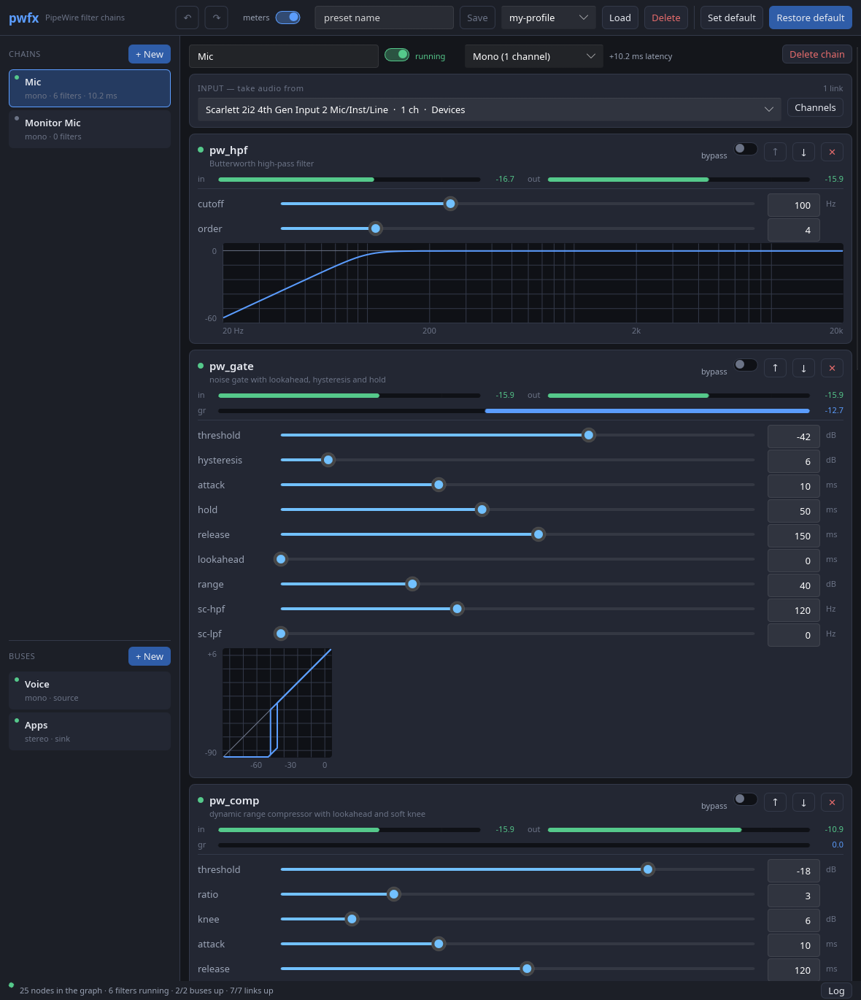

# pw_* — PipeWire filter nodes

Eleven audio filters, each a standalone PipeWire filter node built on
`pw_filter`. Six are ported from the raw stdin/stdout reference
implementations in `reference/`; `pw_delay`, `pw_deess` and `pw_denoise` were
written here together with references of their own -- `pw_denoise` around
RNNoise, vendored in `third_party/rnnoise`; `pw_sccomp` is `pw_comp`'s core
with an external key, and is held to `reference/comp.c` itself; `pw_gain` has
none, and is checked against arithmetic instead.

| filter | what it is | latency |
|---|---|---|
| `pw_lpf`   | Butterworth low-pass, order 1..16 | none |
| `pw_hpf`   | Butterworth high-pass, order 1..16 | none |
| `pw_eq`    | 5-band parametric EQ: low shelf, three bells, high shelf | none |
| `pw_gate`  | noise gate with lookahead, hysteresis and hold | lookahead |
| `pw_comp`  | compressor, log-domain detector, soft knee, lookahead | lookahead |
| `pw_sccomp` | `pw_comp` keyed by a separate mono input, `sc_in`: ducking | lookahead |
| `pw_limit` | true-peak brickwall limiter | lookahead + 12 samples |
| `pw_gain`  | gain, mute, polarity per side, balance; every change ramped | none |
| `pw_delay` | delay up to 2 s, with feedback and mix for an echo | none reported (the delay is the effect) |
| `pw_deess` | de-esser: split-band dynamic EQ or wide, relative or absolute detection | lookahead |
| `pw_denoise` | noise suppression for voice (RNNoise), limited reduction, optional voice gate; 48 kHz | 30 ms |

Each one takes its settings from the command line, prints them on stdout at
startup, and accepts changes on stdin while audio is flowing.

There is also a desktop app, [`app/`](app/), that drives them: it finds the
filter binaries, builds chains out of them, offers virtual devices to hang
the chains on, and wires the graph up. See [app/README.md](app/README.md).

## Build

```sh
make            # the filters, into bin/
make test       # DSP cores diffed against reference/, offline
make check      # the above plus the live PipeWire tests
make app        # the filters and the GUI (needs cargo)
make appimage   # the GUI and filters as one AppImage, in dist/ (needs podman)
```

Needs `libpipewire-0.3` development headers and a C compiler. The live tests
additionally need a running PipeWire daemon with `pw-cat`, `pw-link` and
`pw-dump`. The GUI additionally needs a Rust toolchain. `make appimage` needs
only podman: it builds everything inside a Debian 12 container, so the result
runs on Debian 12, Ubuntu 24.04, Fedora 37 and anything newer.

## Running one

```sh
./bin/pw_hpf -c 2 -f 80 -n 4
```

The node appears in the graph as `pw_hpf` with ports `in_1`, `in_2`,
`out_1`, `out_2`. Nothing auto-connects it — these are plain filter nodes
with no `media.class` — so wire it up yourself:

```sh
pw-link some-source pw_hpf
pw-link pw_hpf some-sink
```

Use `--node-name` to run several instances of the same filter, `--target` to
have the session manager connect it automatically, and `--node-latency` to
ask for a particular quantum (`256/48000`).

## Control protocol

**On start** every parameter is printed to stdout, one per line, as
`name value`:

```
channels 2
rate 48000
latency 0
bypass off
max-rate 192000
node-name
target
node-latency
cutoff 80
order 4
```

**On stdin** each line sets one parameter, and the new value is echoed back
in the same form:

```
$ echo "cutoff 120" >&0
cutoff 120
```

Accepted forms are `name value`, `name=value` and `name:value`. A bare
parameter name queries it. `dump` reprints everything, `help` prints the
usage text, `quit` exits. Blank lines and lines starting with `#` are
ignored.

**Everything on stdout** is either a `name value` line or a `#`-comment, so a
controller can parse it without special cases. Errors go to stderr as
`error: ...` and leave the parameter unchanged:

```
error: order: 99 is out of range [1, 16]
error: hs-slope: high shelf slope S=6 is too steep for a +20 dB shelf (max 2.28 here); ...
```

A change can produce more than one line: moving `lookahead` moves `latency`
with it, and the filter says so.

### Level metering

`in-level` and `out-level` are peak meters in dBFS, read-only. They are the
one thing that writes to stdout unasked, so they are off until you ask:

```
meter 100
in-level -5
out-level -10.5
in-level -5
out-level -10.4
```

`meter <ms>` sets the reporting interval and `meter 0` switches it off again.
Arming it always reports once, so turning it on over a silent signal still
confirms it is working. A bare `in-level` queries it at any time, but with
`meter 0` the realtime thread is not measuring, so what comes back is the last
value from when it was on — or -240 if it never was.

A reading is a peak hold that falls back at 20 dB/s, so a single one can sit
under the true peak; the highest over a run is the one to trust. `out-level`
is measured after the bypass crossfade, so it is what the filter produces,
bypass included -- and it is measured whether or not anything is connected
to the output, so a stage being set up before it is wired still shows what
it is doing.

On the lookahead filters `out-level` lags `in-level` by the lookahead, so the
two are not the same instant of audio — don't subtract them to get gain
reduction. Read `gr` instead.

### Gain reduction

`pw_gate`, `pw_comp`, `pw_sccomp`, `pw_limit`, `pw_deess` and `pw_denoise` have a third meter, `gr`: how far the
filter is pulling the level down, in dB, as a positive number. It is
reported on the same `meter` timer as the levels, and held the same way,
falling back at 20 dB/s. The other filters have no `gr` at all: it is
absent from their dump and their `--help`, and asking for it is an unknown
name, so a consumer can tell from the dump which filters have one.

```
meter 100
in-level -10.5
out-level -25.1
gr 14.7
```

It is the gain the audio is actually multiplied by, measured at the
moment it is applied:

- `pw_comp`: the smoothed reduction, without makeup -- 6 dB of makeup
  does not make 14.7 dB of compression read as 8.7. Under `link off`, the
  channel being reduced the most.
- `pw_sccomp`: the same, driven by the key on `sc_in`; 0 while nothing is
  linked to it.
- `pw_gate`: the closed gate reads its `range`. A gate snapped to silence
  (`range` 90 or more) has no finite number of dB to report, so it reads
  its range as well.
- `pw_limit`: the smoothed gain after the lookahead, not the detector's
  instantaneous demand, so it rises over the lookahead rather than in one
  step.
- `pw_deess`: the smoothed cut. In split mode that is exactly the cut at
  the band's centre; in wide mode, the cut to everything.
- `pw_denoise`: how much quieter each 10 ms frame came out than it went in
  -- the noise it took away, and nothing while someone is talking.

A fully bypassed filter reads 0: it is still computing a gain, but none of
it reaches the output.

### Sidechain level

`pw_sccomp` has one more meter, `sc-level`: the peak level arriving at
`sc_in`, in dBFS, reported and held like `in-level`, which does not include
it. With nothing linked to `sc_in` it reads the -240 floor. The other
filters have no `sc-level` at all, as they have no `gr`.

Measuring costs almost nothing while `meter` is 0: the realtime thread
checks one atomic and skips the level scan entirely. The dynamics filters
keep taking their block's reduction, one comparison per sample in the core,
so that turning the meter on reports the present rather than the worst
moment since startup.

### Response curves

Every filter can say what it does, computed from the coefficients it is
actually running -- not from a second model of it. Ask on stdin:

```
curve
curve freq 20:0.00,20.8881:0.00,21.8155:0.00,...
```

or get the same line without PipeWire, for whatever the command line sets:

```sh
./bin/pw_lpf -f 1000 -n 4 --curve
```

One `name value` line like any other, sent only when asked for. The kind
is the axes:

- `freq`: `HZ:DB` pairs, log-spaced from 20 Hz to 20 kHz (or to just under
  Nyquist), for `pw_lpf`, `pw_hpf` and `pw_eq`. The EQ's is the sum of the
  bands that are on, so a band switched off by a rate change is missing
  from the curve as it is from the sound.
- `level`: `IN:OUT` pairs in dB, -90 to +6, the static curve of `pw_comp`
  (makeup included), `pw_gate` and `pw_limit` -- where a steady input ends
  up, not how fast it gets there.

The points are a path, in drawing order. For most filters that is one y per
x, but a gate's is a loop: up the closed line to the threshold, up to open,
to the top, back down the open line to `threshold - hysteresis`, and down
to closed. Drawn in order, that is its hysteresis. A filter lists `--curve`
in its `--help` exactly when it has one.

Driving one from a script:

```sh
mkfifo /tmp/eq.ctl
./bin/pw_eq -c 2 < /tmp/eq.ctl &
exec 3> /tmp/eq.ctl
echo "b3-freq 2500" >&3
echo "b3-gain 3"    >&3
```

## Common parameters

Every filter has these on top of its own:

| name | |
|---|---|
| `channels` | number of mono port pairs, 1..64 (command line only) |
| `rate` | the graph's sample rate, reported when it changes (read-only) |
| `latency` | samples of latency this filter adds, reported to the graph (read-only) |
| `bypass` | pass the input through, crossfaded over 10 ms so it cannot click; a filter with latency keeps it, so bypassing does not move the audio in time |
| `meter` | how often to report `in-level`, `out-level`, `gr` and `sc-level`, in ms; 0 (the default) is off |
| `in-level`, `out-level` | peak level at the input ports, and of the filter's output whether connected or not, in dBFS, floored at -240 (read-only) |
| `gr` | gain reduction being applied, dB; `pw_gate`, `pw_comp`, `pw_sccomp`, `pw_limit`, `pw_deess` and `pw_denoise` only (read-only) |
| `sc-level` | peak level arriving at the sidechain input, dBFS; `pw_sccomp` only (read-only) |
| `max-rate` | the highest rate delay lines are sized for at startup (command line only) |
| `node-name`, `target`, `node-latency` | PipeWire plumbing (command line only) |

`--help` lists every parameter with its range, unit and default.

## The app

```sh
make app
./app/target/release/pwfx
```



A patchbay: it lists every source and sink on the system, lets you build any
number of filter chains out of the binaries in `bin/`, and keeps the graph
linked to match. It learns each filter's parameters by parsing its `--help`,
so a new `pw_*` program appears in it with the right knobs and no changes to
the app. Mono and stereo are matched up automatically -- by channel name where
the names agree, by position otherwise -- and any pairing can be overridden.

It also makes **buses**: virtual devices that other applications on the
machine can use. A source bus is a microphone your conferencing app records
from; a sink bus is an output other programs play into. Any number of chains
can share one, in either direction, so a bus is where several chains become
one thing the rest of the system can select.

Chains, buses, routing and settings are saved, with named presets and a
default state to go back to.

Full description in [app/README.md](app/README.md).

## A chain, by hand

```sh
./bin/pw_hpf   -c 2 -f 80  -n 4 --node-name chain-hpf   &
./bin/pw_comp  -c 2 -t -18 -R 3 --node-name chain-comp  &
./bin/pw_limit -c 2 -C -1       --node-name chain-limit &

pw-link mic         chain-hpf
pw-link chain-hpf   chain-comp
pw-link chain-comp  chain-limit
pw-link chain-limit speakers
```

Each stage reports its own latency, so PipeWire knows the total.

## Ducking, by hand

`pw_sccomp` has one more input than it has outputs: `sc_in`, a mono
sidechain the detector listens to instead of the audio. Music in, a voice on
the key, and the music gets out of the voice's way:

```sh
./bin/pw_sccomp -c 2 -t -35 -R 6 -e 400 -F 150 --node-name duck &

pw-link music:output_FL  duck:in_1
pw-link music:output_FR  duck:in_2
pw-link mic:capture_MONO duck:sc_in
pw-link duck:out_1 speakers:playback_FL
pw-link duck:out_2 speakers:playback_FR
```

Link port by port: a node-to-node `pw-link` decides by itself which input
gets what. With nothing on `sc_in` the key is silence and the audio passes
untouched (makeup aside). In the app, the stage card has a **sidechain**
picker for this instead.

## What changed from the reference implementations

The DSP did not. `make test` diffs every ported filter's core against the
reference binary built from `reference/`, byte for byte, across orders, block sizes and
edge settings — same coefficients, same transposed direct form II, same
double-precision state, same denormal flushing.

Three things had to change around it:

**Latency is real.** The reference gate, compressor and limiter absorb their
lookahead delay: they swallow the first *L* output samples and flush *L* more
at EOF, so their output is sample-aligned with their input and exactly as
long. A filter in a live graph cannot do that — looking ahead means being
late. Here the output really is delayed, and the delay is published as
`SPA_PARAM_ProcessLatency` so PipeWire compensates for it. The offline tests
reinstate the absorb-and-flush around the same code, which is what makes the
byte-for-byte comparison possible.

**The sample rate comes from the graph**, not from `-r`. It is reported as a
read-only `rate` parameter and the coefficients are redesigned if it changes.

**Every parameter is live.** The reference designs its filter once at
startup; here a parameter can move at any time. Two consequences worth
knowing:

- Changing a *lookahead* steps the delay line and is audible as a click. It
  is not a knob to ride — set it and leave it. Everything else is smooth.
- `pw_eq` takes each band's three numbers as separate parameters
  (`b3-freq`, `b3-gain`, `b3-q`) rather than the reference's packed
  `--b3 2500:3:0.9`, so each is one line of the protocol.
- `pw_gate` takes `hysteresis` (the gap below the open threshold) rather than
  the reference's absolute `--close`, so moving the threshold carries the
  close point with it. `--close -41` with `-t -35` is `hysteresis 6` here.

## How the live parameters work

Parameters are edited on the main loop thread; audio is processed on the
realtime thread. Nothing mutable is shared between them.

    main thread   design()  -> writes a fresh plain-data coefficient blob
                               into a free slot of a ring, then publishes the
                               slot with a release store of a counter
    data thread   process() -> acquire-loads the counter, reads that slot,
                               never writes to it

The blob has no pointers and needs no allocation. Anything whose size depends
on a parameter — delay lines, lookahead windows — is allocated once at
startup for the worst case (`max-rate` at the largest legal setting) and the
blob carries only the length currently in use. So publishing a change is
wait-free for the reader and allocation-free for both, which is what makes
every parameter live-changeable rather than startup-only. The counter doubles
as the "configuration changed" signal the filter uses to reset whatever
geometry moved.

## Tests

```
tests/run.sh       DSP cores vs. reference/, byte for byte, plus a check
                   that the limiter's ceiling is never breached
tests/curves.py    every filter's --curve against theory: the bilinear
                   Butterworth response point for point, the compressor's
                   and limiter's static curves, the gate's loop
tests/protocol.py  the stdin/stdout contract
tests/gain.py      pw_gain per channel in the graph: each side's level and
                   polarity, and no clicks while switching any of it
tests/impulse.py   pw_delay's impulse response against theory, offline
tests/sccomp.py    pw_sccomp offline: byte for byte against reference/comp.c
                   on streams where the original hears exactly the key,
                   then the cut, release and lookahead against the design
tests/sidechain.py pw_sccomp in the graph: the key on sc_in sets the cut,
                   is never heard, and nothing on it means no cut
tests/deess.py     pw_deess against its design equations, offline: the
                   cut at the centre, on the skirt, capped by the range,
                   in both detections and both modes, and bit-exact idle
tests/delay.py     pw_delay in the graph: the delay exact to the sample,
                   none of it reported as latency, no click on a change
tests/bypass.py    bypassing a lookahead filter keeps its timing, and its
                   crossfade does not comb the signal with itself
tests/meter.py     out-level with the output connected to nothing: the
                   right level, from the loudest channel
tests/denoise.py   pw_denoise on real speech, offline: RNNoise lines up
                   with its input, the reduction is a limit, the gate is
                   exact, speech survives and the noise between it goes
tests/live.py      one filter in the real graph: node and ports, live
                   parameter changes, reported latency, and the measured
                   frequency response of audio played through it
tests/chain.py     three filters wired in series: ports link, latencies
                   add up, and the limiter's ceiling still holds at the end
tests/stress.py    parameters hammered at random while audio flows, to
                   exercise the coefficient handoff
tests/all.sh       all of the above  (make check)
```

`tests/live.py` measures rather than asserts liveness: it plays a test signal
into the filter's input ports, records the output ports, and compares the
level at each probe tone against what the settings predict — 24 dB/octave per
order for the Butterworths, the static curve for the compressor, the ceiling
for the limiter.

Set `PWF_OFFLINE_ONLY=1` to skip everything that needs a daemon.
