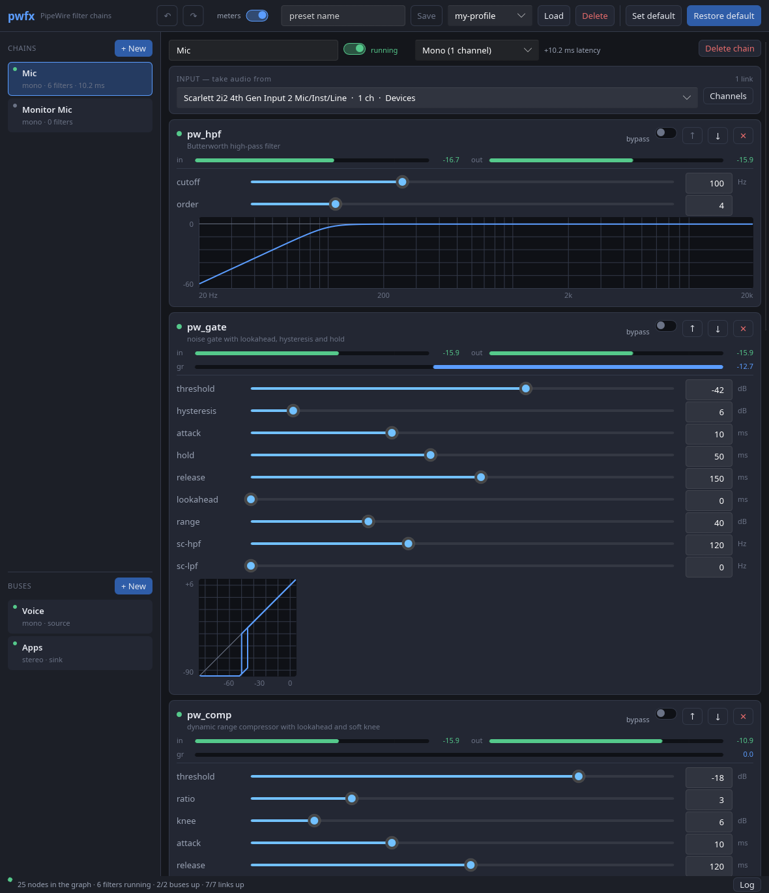

# pwfx — a patchbay for the `pw_*` filters

A Rust/Slint desktop app that treats the filter binaries in `../bin` as
plugins. It shows every source and sink on the system, lets you build any
number of filter chains out of them, gives you virtual devices to hang them
on, and keeps the PipeWire graph wired to match.

```sh
make app          # from the top of the tree; builds the filters too
./app/target/release/pwfx
```



## What it does

- **Finds the filters itself.** Every `pw_*` program on the search path is
  asked for its `--help` and the reply becomes a parameter table. A seventh
  filter dropped into `bin/` shows up in the "Add filter" list with the right
  knobs, ranges, units and defaults, and nothing in this app has to be
  recompiled. See [`src/plugin.rs`](src/plugin.rs).
- **Chains.** A chain is a source, an ordered row of filters and a sink. Each
  stage runs as its own process, and the stages are linked in series. Stages
  can be added, removed, reordered and bypassed while audio flows.
- **Routing.** Sources and sinks are chosen from the live graph — buses,
  hardware inputs and outputs, virtual devices, sink monitors and application
  streams. A chain with no filters in it at all is a plain patch cable.
- **Buses.** A bus is a virtual device the app asks the daemon for, and it is
  what other applications on the machine talk to. A **source** bus is a
  microphone: chains feed it, and your conferencing app records from it. A
  **sink** bus is an output: applications play into it, and chains take the
  audio back off it. Any number of chains can share one bus in either
  direction — PipeWire sums what arrives — so a bus is where several chains
  become one thing the rest of the system can select. Buses go when the app
  does; nothing is left behind in the graph.
- **Channels.** A chain is mono, stereo or up to 64 channels wide. Matching
  the world to it is automatic: same-named channels line up (so FL/FR find
  FL/FR whatever order the device declares them in), and anything else falls
  back to position, wrapping on both sides — which is what makes a mono mic
  feed both sides of a stereo chain and a stereo source fold down into a mono
  one. Any pairing can be overridden in the channel matrix.
- **Saving.** The session is written out as you work. Named presets and a
  "default state" that **Restore default** goes back to are the same file
  format, so they are interchangeable and editable by hand.
- **Meters.** Every stage shows the input and output peak levels the filter
  reports, as a bar and as a figure in dBFS, and the latency it adds. The
  figure is what the filter last reported: a peak hold that falls back at
  20 dB/s, so the highest reading over a run is the one to trust. Silence
  reads as `—` rather than as the filters' -240 dB floor.

## How it is put together

One loop, repeated at four levels, and nothing else:

```
  AppState          what the user asked for        src/state.rs
     │ Engine::apply
  processes         one filter binary per stage    src/process.rs
     │ PwCmd::SetNodes
  bus nodes         one null sink per bus          src/pwthread.rs
     │ PwCmd::SetLinks
  links             resolved by name, per tick     src/pwthread.rs
```

Each level compares what *is* against what *should be* and closes the gap.
Every user action is therefore the same action — edit the state, then apply
it — and the awkward cases are not special-cased anywhere, because they are
just the next comparison coming out differently:

| what happens | what makes it work |
|---|---|
| an interface is unplugged | its node leaves the registry, its links stop resolving, the rest of the chain keeps running |
| it is plugged back in | the name resolves again and the links are remade |
| a filter crashes | the next pass sees it is gone and starts it again, with backoff if it will not stay up |
| the daemon restarts | the PipeWire thread reconnects and replays the wanted links |
| a preset is loaded | it is compared against what is running; stages that did not change are left alone, audio and all |
| a bus is renamed | its `node.description` moved, so the node is made again under the new one; its `node.name` did not, so the chains on it never notice |

Two rules follow from the filters' own design and are worth knowing before
changing anything here:

**The filter is the authority on its own parameters.** The app sends what the
user asked for and displays what comes back. Rounding, clamping, a rejected
cross-parameter combination, and the extra `latency` line that a changed
lookahead drags with it all land in the window without it modelling any of
them — see `Engine::absorb_reports`. A value the filter refuses simply never
moves on screen, and the reason appears in the log.

**Links are declared, not commanded.** The GUI never says "connect this to
that". It hands the PipeWire thread the set of links that ought to exist, by
node and port *name*, and that thread re-resolves the whole set on every
registry change. Ids change constantly — every restart, every profile switch —
and names do not.

## Layout

| file | |
|---|---|
| `src/plugin.rs` | discovers the binaries and parses `--help` into a parameter table |
| `src/process.rs` | one running filter and the line protocol on its pipes |
| `src/graph.rs` | the PipeWire graph as the GUI sees it, and the channel matching |
| `src/pwthread.rs` | the PipeWire thread: registry, snapshots, node and link reconciliation |
| `src/engine.rs` | state → processes → wanted buses and links |
| `src/state.rs` | the save file, which is the whole user-visible model |
| `src/ui.rs` | slider positions and value formatting |
| `src/main.rs` | the window: state into models, clicks into edits |
| `ui/*.slint` | the window itself |

## Environment

| | |
|---|---|
| `PWFX_FILTER_PATH` | colon-separated directories to look for `pw_*` in. Otherwise: next to the executable, then the tree's own `bin/`. |
| `PWFX_CONFIG_DIR` | where to keep the save files. Otherwise `$XDG_CONFIG_HOME/pwfx`, or `~/.config/pwfx`. |

Save files: `session.json` (written as you work, restored at start),
`default.json` (**Save as default** / **Restore default**, and what a first
run starts from), `presets/*.json`.

## Notes and limits

- Changing a chain's **width** restarts its filters: the channel count is a
  command-line parameter in them, not a live one. Everything else is live.
- Changing a **lookahead** steps the filter's delay line and is audible. That
  is the filters' documented behaviour, not something this app smooths over —
  set it and leave it.
- Chains cannot be fed from other chains directly — the filter stages are
  kept out of the endpoint pickers — but they can be fed **through a bus**,
  which is the supported way to join them up. Nothing stops you wiring a
  chain's output back round to its own input through one; the app does not
  detect cycles and PipeWire will simply refuse to run the loop.
- Changing a bus's **width** or its **kind** makes the node again, because
  both are fixed when a null sink is created. Any application streaming
  through it at the time is moved off it by the session manager.
- Links and buses alike are made without `object.linger`, so closing the app
  removes exactly what it made and leaves the rest of the graph as it found
  it. The filter processes get `PR_SET_PDEATHSIG` as well, so they do not
  outlive the GUI even if it is killed.

## A trap worth knowing about

The std widgets own their own value. Typing into a `LineEdit` or dragging a
`Slider` writes the property, and in Slint writing a property **removes the
binding that was feeding it**. From that moment the widget shows what the user
did rather than what the model says, and nothing gets it back in step.

That cost a bug: `LineEdit::accepted` only fires on Enter, so a figure typed
and then clicked away from was displayed but never committed. It looked saved
until the next start, and it was worst on `pw_eq`, which is sixteen numeric
fields and whose defaults are a passthrough — so a lost setting means the EQ
audibly does nothing.

So every editor in `ui/parts.slint` does two things, and a new one has to do
both: commit on losing focus as well as on Enter, and push the model back into
the widget with a `changed p` handler whenever it moves — but never into a
widget that currently has focus, which would fight the user mid-edit. Reading
the model back straight after committing is what makes a value the filter
clamped or refused correct itself on screen.

The dropdowns cost a second bug, because a widget does not need the user's
help to write its own value. `ComboBoxBase::reset-current()` clamps and writes
`current-index` **every time the model changes**, which is often here — every
device that appears and every application that starts playing is a new entry
in the endpoint lists, and a daemon restart empties them and fills them again.
The write is a no-op while the clamp does not move the value, so nothing goes
wrong for a while; the first time a list shrinks past the selection the
dropdown comes off its binding for good and shows whatever index it kept, read
against a list that has since grown back. A chain that was plugged in reads as
plugged into something else, often the first entry.

Every dropdown whose value belongs to the state therefore goes through
`Picker`, which pushes the index back on `changed options` as well as on
`changed index` — both, because the list can change while the index stays the
same number, and that is precisely the case the widget gets wrong on its own.

## Tests

```sh
cargo test
```

48 of them. Five are worth pointing at:

- `window_tests` drives the real widgets headlessly through Slint's testing
  backend — it clicks into a field, types, clicks away, and asserts the value
  was committed and that the field still follows the model afterwards; and it
  shrinks an endpoint list past the selection and grows it back, asserting the
  dropdown still names the right node. These are the regression tests for the
  two traps above; each fails if its half is removed.
- `engine::round_trip` starts a real `pw_eq`, feeds it a saved chain and
  asserts the filter reports back exactly what was asked for, then that
  adopting its report and a JSON cycle both leave the state alone. Needs a
  PipeWire daemon; skips without one.
- `plugin::against_the_real_filters` parses the actual binaries in `bin/`, so
  a change to the help formatter in `src/pwf.c` fails here rather than
  silently emptying the window.
- `engine::tests` pins the exact link set each routing case should produce,
  including mono fan-out, stereo fold-down, an absent device, and two chains
  summing into one bus — plus the shape of the node each bus asks for.
- `picker_tests` pins the one place a bus has to behave unlike the app's
  other nodes: the endpoint pickers hide filter stages and offer buses,
  although both carry the `pwfx.` prefix.

## Building without `fontconfig-devel`

`Cargo.toml` depends on `fontique` purely to turn on its `fontconfig-dlopen`
feature. Slint reaches fontconfig through that crate, whose default path wants
`fontconfig.pc` at build time; loading `libfontconfig` at runtime instead keeps
the build free of system `-devel` packages. Nothing here calls fontique.
